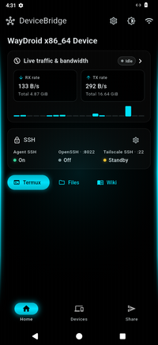
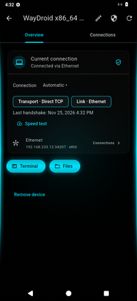
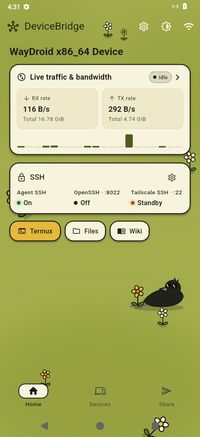
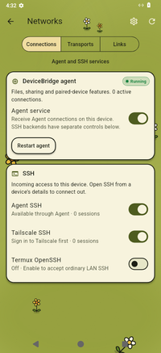

<div align="center">

# DeviceBridge

**Zero-cloud, mTLS-authenticated file transfers, remote shell & terminal, Quick Share, and Git-aware folder synchronization across Android, Termux, and Linux.**

[](https://github.com/afzlwtu-2/device-bridge/actions/workflows/ci.yml)
[](https://github.com/afzlwtu-2/device-bridge/actions/workflows/release.yml)


</div>

DeviceBridge turns your own devices into a fast, private, cryptographically verified peer network. Browse approved directories, stream gigabytes over direct Wi-Fi/LAN with **XXH64** verification, open an interactive SSH/PTY shell over mTLS or Termux, share files and text via Quick Share, and coordinate Git-aware folder sync — **without uploading your data to third-party clouds, forcing root, or punching open untrusted ports**.

---

## Screenshots (AMOLED & Matte Themes)

> Click any thumbnail below to view the full-resolution screenshot.

<table>
  <tr>
    <td align="center">
      <a href="docs/screenshots/amoled-home.png">
        
      </a><br />
      <sub><b>AMOLED · Home</b><br />Live traffic &amp; SSH status</sub>
    </td>
    <td align="center">
      <a href="docs/screenshots/amoled-overview.png">
        
      </a><br />
      <sub><b>AMOLED · Device Overview</b><br />Route picker, Terminal &amp; Files</sub>
    </td>
    <td align="center">
      <a href="docs/screenshots/matte-home.png">
        
      </a><br />
      <sub><b>Matte · Home</b><br />Custom Matte Paper canvas</sub>
    </td>
    <td align="center">
      <a href="docs/screenshots/matte-networks.png">
        
      </a><br />
      <sub><b>Matte · Networks</b><br />Agent &amp; 3 SSH backends</sub>
    </td>
  </tr>
</table>

---

## Why Use DeviceBridge?

- **Zero-Cloud Privacy & Cryptographic Trust:** Every device generates an Ed25519 identity keypair and communicates over mutually authenticated **TLS 1.3 (mTLS)**. Pairing uses 256-bit single-use QR/code invitations with explicit fingerprint confirmation — IPs and mDNS hostnames never establish trust.
- **Direct-First High Throughput:** Streams files and tar bundles directly over LAN/Wi-Fi/Ethernet TCP with kernel-friendly chunking, automatic **XXH64** verification (`xxhsum -H1`), resumable `.devicebridge-part` staging, and atomic no-overwrite publication (`renameat2(RENAME_NOREPLACE)`).
- **Smart Multi-Transport Failover:** Prefers verified direct LAN first, automatically falls back to **Tailscale** (`tsnet` app-private node on Android — no system VPN slot taken) or **WireGuard**, and supports **USB ADB reverse**, **Wi-Fi Direct**, and **Hotspot** setup with per-device bulk data consent.
- **Root-Optional Privilege Tiers:** Designed around **Standard** (normal unprivileged Android UID + SAF), **Shizuku**, and opt-in **Root** (verified live via `su -c id -u`, never blindly cached). Everything core works without root or Termux.
- **Git-Aware & Single-Writer Safe:** Pulls are one-off downloads; registered folder sync uses a privately supervised **Syncthing v2.1.7** engine with single-writer signed handoffs, Git-cleanliness checks, and exclusion of `.git` / regenerable build caches unless you explicitly choose a full mirror.
- **Built-in Terminal, Termux & SSH:** Includes an embedded `xterm3` terminal, package-adaptive Termux compatibility (`libdb_termux_adapt.so`), Termux Home backup/restore, and three independently controllable SSH entry points.

---

## Current Features

### Networking, Routing & Discovery
- **LAN Discovery & Pairing:** IPv4 mDNS/DNS-SD discovery, QR code scanning & invitation generation, local device aliases, and 30-second endpoint caching scoped to interface/subnet.
- **Per-Peer Route Control & Roaming:** Independent transport preference (`Automatic`, `Direct TCP`, `Tailscale`, `WireGuard`, `USB ADB`) and local link preference (`Wi-Fi`, `Ethernet`, `Hotspot`, `Wi-Fi Direct`), with live foreground route recovery when subnets change.
- **Built-in Speed Test & Traffic Telemetry:** Live RX/TX rate bar graph on Home plus per-transport, SSH session, SOCKS5 proxy, and Android UID socket breakdown in **Live traffic**.
- **App-Private Tailscale Proxy:** Optional loopback SOCKS5 proxy backed by DeviceBridge's Android `tsnet` node via a foreground service without consuming Android's VPN slot.

### Files, Transfers & Folder Sync
- **Scoped Remote File Manager:** Browse explicitly approved filesystem roots (`os.Root` traversal-safe on Linux/Android/Termux), inspect previews/metadata, and export downloads to Android shared storage via **Storage Access Framework (SAF)**.
- **Resumable Verified Pulls:** Interrupted downloads preserve staging locks and resume by verified byte offset with identical manifest and XXH64 verification.
- **Quick Share:** Send/receive text, files, and folders between paired devices with per-peer approval and Android Share Sheet integration.
- **Registered Folder Sync:** Built-in supervised Syncthing v2.1.7 engine supporting **Full folder** and **Working files (excluding `.git`)** modes, **Phone-coordinated two-machine sync** (controller issues metadata commands while endpoints transfer directly), and **Recycle Bin** protection.

### SSH, Termux & Access Control
- **Three Independent SSH Backends:**
  1. **Agent SSH** (`POST /v1/ssh` mTLS upgrade, per-peer approval & 500ms live session revocation)
  2. **Tailscale SSH** (`:22` inside the app-private `tsnet` sidecar)
  3. **Termux OpenSSH** (`:8022` key-auth-only daemon bound strictly to non-loopback/non-Tailscale interfaces)
- **Persistent SSH-Only Hosts:** Save ordinary LAN/SSH endpoints with pinned host-key fingerprints and optional SFTP without requiring a DeviceBridge agent on the target.
- **Adaptive Integrated Termux:** Native `LD_PRELOAD` path/shebang translator (`libdb_termux_adapt.so`) for app-private Termux, APT package transaction hooks, `sudo`/`tsu` wrappers, encrypted-safe Home backup/restore, and optional Root **Keep Termux running** detached PTY sessions.
- **Tailscale-Style ACLs, Tags & Groups:** Define `tag:*` and `group:*` rules across `files:browse`, `files:read`, `ssh`, `share:text`, `share:file`, `sync`, `termux`, `actions`, and `link` with explicit `deny` overrides and default-deny presets.

### Customization & Built-in Docs
- **5 Appearance Modes:** System, Light, Dark, **AMOLED** (customizable neon side-edge glow, peak/tab/button/border colors, thickness & luminosity presets), and **Matte Paper** (interactive botanical/vector canvas editor with custom ink-outlined cards).
- **In-App Wiki:** Built-in documentation explaining security guarantees, transports, privilege tiers (`Standard` / `Shizuku` / `Root`), and troubleshooting.

---

## Future Features & Roadmap

Planned and upcoming capabilities building on DeviceBridge's versioned extension registries (`internal/transport`, `internal/features`, `internal/filesproviders`, `internal/syncproviders`):

- **Web UI:** Authenticated local/tailnet web dashboard for headless servers, NAS boxes, and browser-based file browsing, Quick Share, and terminal sessions.
- **Cross-Platform Desktop UI:** Native **macOS** and **Windows** Flutter desktop apps and Go agents alongside the existing Linux GTK desktop bundle.
- **Broader Device Ecosystem:**
  - **iOS / iPadOS** companion app for encrypted file transfer, Quick Share, and remote monitoring.
  - **Bluetooth RFCOMM** local byte-stream transport for infrastructure-free discovery and short-range exchange.
  - **Headless Server / NAS Packages** (`systemd` units, `.deb`/`.rpm`/Docker packaging) and multi-device mesh coordination.
  - **Remote Clipboard Sync & Screen/Input Helpers** with explicit opt-in consent and ephemeral grants.
  - **Additional Sync & Storage Providers** (SFTP/object-storage providers, optional backup snapshot engines) governed by the same central policy and single-writer controller.

---

## Architecture & Security

| Layer | Technology | Responsibility |
| --- | --- | --- |
| **Core & Agent** | Go (`cmd/bridge-cli`, `cmd/bridge-agent`) | Ed25519 identity, TLS 1.3 mTLS, SQLite WAL state, scoped `os.Root` filesystem, streaming tar/XXH64 transfers, mDNS, ACLs, SSH server |
| **Sidecars** | Go (`spikes/tsnet`, `spikes/wireguard`, Syncthing v2.1.7) | App-private Tailscale (`tsnet`) + SOCKS5, userspace/kernel WireGuard, supervised external folder sync |
| **App UI** | Flutter / Dart (`app/`) | Shared Android & Linux presentation (`Home`, `Devices`, `Share`, `Files`, `Terminal`, `Networks`, `ACL & Groups`, `Wiki`) |
| **Platform Adapters** | Kotlin (`app/android/...`) & C (`libdb_termux_adapt.so`) | Android ConnectivityManager/NSD, SAF, Foreground services, Wi-Fi Direct/Hotspot, Shizuku/Root tiers, Termux `LD_PRELOAD` |

Deep-dive documentation:
- [Architecture Overview](docs/ARCHITECTURE.md)
- [Security Boundaries & Limits](docs/SECURITY.md)
- [Connection Strategy & Roaming](docs/CONNECTION_STRATEGY.md)
- [Folder Sync & Project Handoff](docs/PROJECT_SYNC.md)
- [Remote Actions & Guest Access](docs/GUEST_ACCESS.md)
- [Third-Party Notices](docs/THIRD_PARTY_NOTICES.md)

---

## Installation & Quick Start

### Prebuilt Releases (Recommended)
Download the latest multi-architecture release from the [**GitHub Releases**](https://github.com/afzlwtu-2/device-bridge/releases) page:
- **Android APKs:** `devicebridge-android-arm64-v8a.apk`, `devicebridge-android-armeabi-v7a.apk`, `devicebridge-android-x86_64.apk`, or `devicebridge-android-universal.apk`
- **Linux Desktop:** `devicebridge-linux-x86_64.tar.gz` or `devicebridge-linux-arm64.tar.gz`
- **Standalone CLI / Agent / Termux Cores:** `devicebridge-cli-linux-{amd64,arm64}.tar.gz` & `devicebridge-android-{arm64,arm,amd64}-core.tar.gz`

Verify downloads using the release's `CHECKSUMS.xxh64`:
```bash
xxhsum -H1 --check CHECKSUMS.xxh64
```

Starting with 1.0.1, the Android release build checks GitHub at launch. Settings
shows the installed version and offers **Check for updates**. After you approve,
DeviceBridge downloads the matching APK and verifies its XXH64 and signing key.
With Root mode enabled and verified, DeviceBridge installs the update directly.
Standard and Shizuku use Android's package installer.

For a release, set `version` in `app/pubspec.yaml` and use the matching
`vMAJOR.MINOR.PATCH` tag. The Android build number is
`MAJOR * 1000000 + MINOR * 1000 + PATCH` for every APK variant.
Use the APK for your device's ABI to reduce the download. The universal APK
includes all three ABIs. The release workflow verifies the expected files,
APK version and signing certificate before uploading assets to a draft.
It publishes the draft after GitHub reports the complete upload.

### Build from Source

Prerequisites: Go (`1.26+` / `1.27+` for `spikes/tsnet`), Flutter (`3.50.0` / Dart `3.14.0`), `xxhash` (`xxhsum`), and for Android builds: JDK 21 + Android SDK/NDK `28.2.13676358`.

```bash
# 1. Run Go formatting, vet, race tests, and build Linux CLI/agent
bash scripts/check.sh

# 2. Build Android native core + sidecars (supports DEVICEBRIDGE_ANDROID_ARCH=arm64|arm|amd64)
bash scripts/build_android_core.sh
bash scripts/build_syncthing.sh
bash scripts/build_tsnet.sh
bash scripts/build_wg.sh
bash scripts/prepare_bundled_bins.sh

# 3. Analyze, test, and build the Flutter app
cd app
flutter pub get
flutter analyze
flutter test
flutter build linux --release
flutter build apk --release --split-per-abi
```

### First LAN Session (CLI Example)

```bash
# Initialize state, export a directory, and start the agent on your LAN interface
artifacts/linux/bridge-cli --state .work/my-laptop init 'My laptop'
artifacts/linux/bridge-cli --state .work/my-laptop export shared /absolute/approved/directory
artifacts/linux/bridge-agent --state .work/my-laptop --interface wlan0 --lan-cidr 192.168.1.50/24

# Generate a 5-minute single-use pairing invitation
artifacts/linux/bridge-cli --state .work/my-laptop invite

# After pairing from the Android app, inspect peers and grant scoped read access
artifacts/linux/bridge-cli --state .work/my-laptop peers
artifacts/linux/bridge-cli --state .work/my-laptop approve FULL_PHONE_DEVICE_ID shared 24h 10737418240
```

---

## Contributing & Pull Requests

**Pull requests are very welcome!** Whether it's bug fixes, new transports, UI polish, desktop/web frontends, or documentation improvements, please follow these steps:

1. **Fork & Clone** the repository and create a descriptive feature branch from `main`:
   ```bash
   git checkout -b feat/your-feature-name
   ```
2. **Keep Security & Architecture Invariants Intact:**
   - Never weaken mTLS/Ed25519 identity checks, `os.Root` path scoping, or XXH64 verification.
   - Register new transports, features, or file/sync providers through the existing versioned registries.
   - Never commit private keys, `.pem`/`.jks`/keystore files, local `.env`/`local.properties`, or AI session/handoff files.
3. **Run All Local Checks Before Opening a PR:**
   ```bash
   bash scripts/check.sh
   (cd spikes/tsnet && go vet ./... && go test -race ./...)
   (cd spikes/wireguard && go vet ./... && go test -race ./...)
   cd app && flutter analyze && flutter test
   ```
4. **Open a Pull Request:**
   - Summarize *what* changed and *why*, note any platform/hardware tests you ran (Linux, Waydroid, or physical Android), and include screenshots for UI changes.

See [CONTRIBUTING.md](CONTRIBUTING.md) for detailed developer guidelines.
